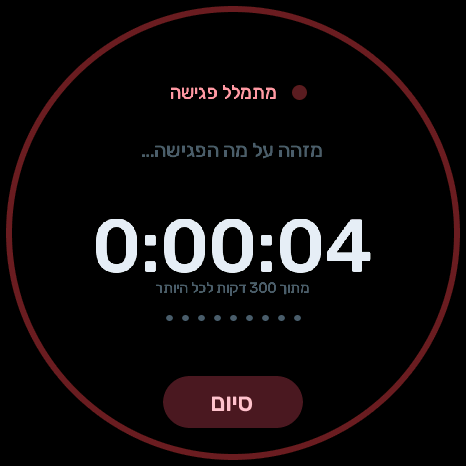
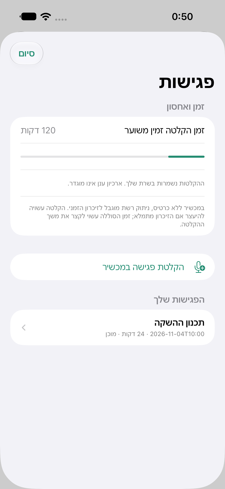
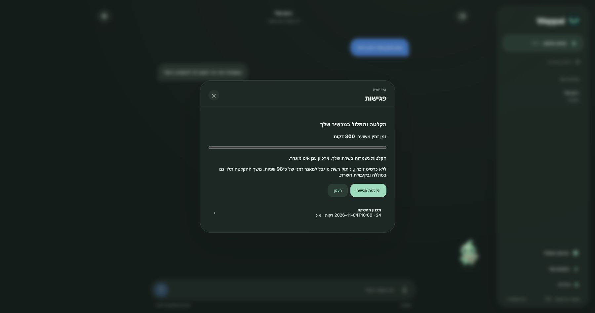
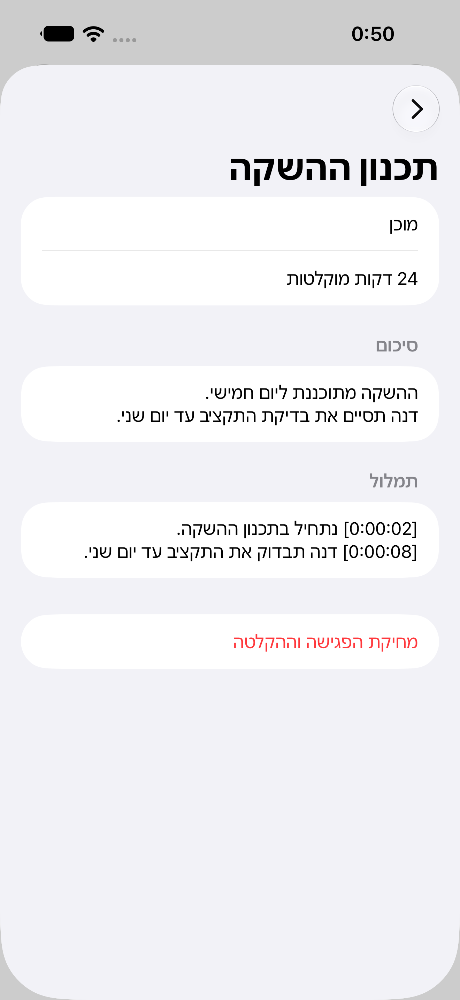
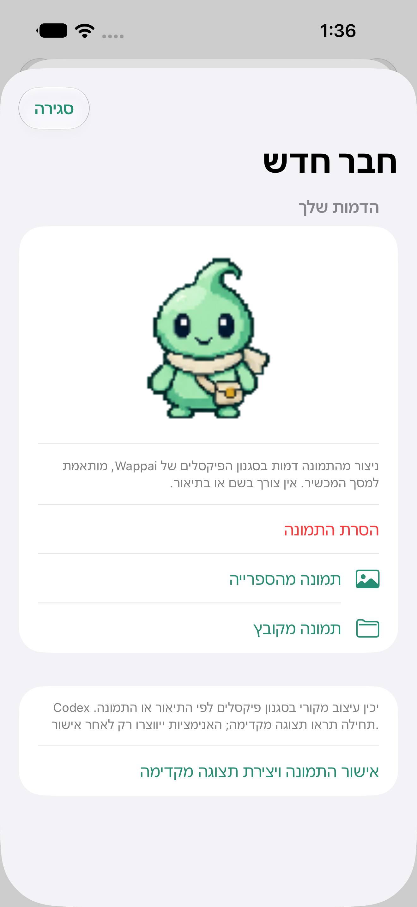
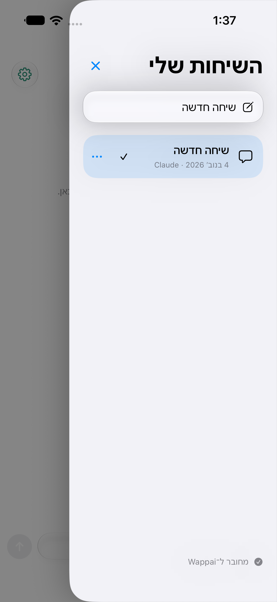
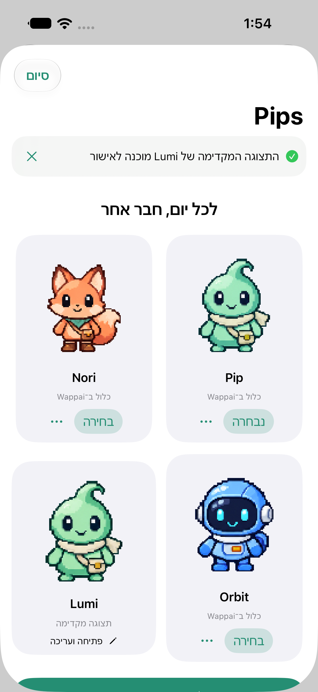
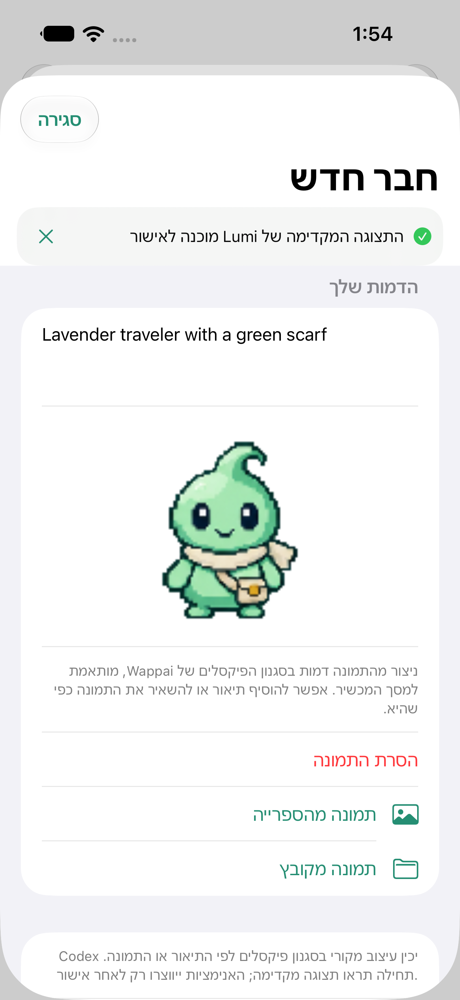

# Wappai — מדריך התקנה ושימוש

Wappai הוא פרויקט תוכנה פתוח לעוזר אישי על מכשיר Waveshare, עם אפליקציית iOS וממשק Web. אין קשר מסחרי ליצרן החומרה. זו גרסת פיתוח; בדקו את טבלת התמיכה לפני רכישה או צריבה.

## 1. מה צריך

- **מכשיר נתמך: Waveshare 1.75C העגול במארז הכסוף**, כבל USB להעברת נתונים ורשת Wi‑Fi בתדר 2.4GHz. דגמי 1.75 הרגיל, 1.8 ו־2.16 אינם מוכנים להפצה; אין לצרוב עליהם קושחת 1.75C.
- מחשב Mac, Windows או Linux שיישאר פעיל בזמן השימוש. אין צורך לשכור שרת פרטי, אך דרוש מחשב שמריץ את ה־Hub. כשהמחשב ישן, התמלול, המענה וה־Push מרחוק אינם זמינים.
- Python 3.11 ומעלה, FFmpeg ומקום פנוי לאודיו ולמודל התמלול. מומלץ להתחיל עם 10GB פנויים. זמני התמלול תלויים במעבד ובמודל.
- Claude Code מחובר לחשבון שלך עבור סיכומי פגישות; לשיחות אפשר להגדיר גם את Codex. שימוש בספקי AI ובשירותי קול כפוף לחשבון, לתנאים ולעלויות שלהם.
- iPhone עם iOS 18 ומעלה. האפליקציה עדיין לא זמינה בחנות; כרגע בונים וחותמים דרך Xcode. אל תתייחסו לקובץ IPA לא חתום כהתקנה רגילה.

## 2. הורדת הפרויקט והפעלת Hub

```sh
git clone https://github.com/rotem221/Wappai.git
cd Wappai
python3 --version
```

**macOS:** התקינו Python עדכני מהאתר הרשמי (עם Tkinter), FFmpeg דרך מנהל החבילות שבחרתם, והפעילו `desktop/Wappai.command`. אם `python3` מצביע לגרסת המערכת הישנה, הפעילו `python3.12 desktop/wappai_hub.py` או את הגרסה העדכנית שהתקנתם.

**Windows:** התקינו Python מ־python.org, כולל Tcl/Tk, ואת FFmpeg והוסיפו אותם ל־PATH. הפעילו `desktop/Wappai.bat`. יש לאפשר לשרת גישה ברשת הפרטית בהודעת חומת האש; אין צורך לפתוח פורטים בנתב.

**Linux:** התקינו Python 3.11+, חבילת venv, Tkinter ו־FFmpeg דרך מנהל החבילות של ההפצה. הפעילו `desktop/wappai.sh`.

המפעיל הוא יישום קטן מהקוד המקורי, לא חבילת התקנה חתומה. בדיקת קוד בוצעה ב־macOS; בדיקת GUI וחבילות הפצה ב־Windows/Linux עדיין נדרשת לפני הצגתן כתוכנות מוכנות להורדה.

בחלון Wappai Hub:

1. **Check setup** מציג אילו רכיבים זמינים. פלט הבדיקה אינו כולל מפתחות.
2. **Install Hub** יוצר סביבה נפרדת בתיקיית `~/.wappai/venv` ומתקין את התלויות. בפעם הראשונה התמלול עשוי להוריד מודל.
3. התחברו ל־Claude Code/Codex באמצעות ההליך הרשמי שלהם, בחשבון מערכת ההפעלה שמריץ את ה־Hub.
4. **Start** מפעיל את השרת בפורט 8770 וממתין לאישור שהשרת מוכן. פורט תפוס, תהליך שנכשל או חריגה מזמן העלייה מציגים שגיאה במקום הודעת הצלחה. פרטים ביומן `~/.wappai/hub.log`. **Open Wappai** פותח את הממשק ב־`http://localhost:8770`.
5. **Pair app** מפיק קוד לאפליקציה וקוד כניסה לדפדפן. אלה קודים פרטיים קצרי תוקף; אל תפרסמו אותם בצילומי מסך.
6. **Stop**, או סגירת החלון לאחר אישור, מפסיקים את השרת. אל תסגרו בזמן הקלטה או עיבוד.

ההגדרות הפרטיות נמצאות ב־`~/.wappai/hub.env`, הנתונים ב־`~/.wappai/data`, והיומן ב־`~/.wappai/hub.log`. אין לשמור קבצים אלה ב־Git ציבורי. ב־Windows יש לוודא שגם הרשאות התיקייה מוגבלות למשתמש שלכם.

אפשר גם להפעיל ידנית:

```sh
python3 -m venv .venv
# macOS/Linux:
. .venv/bin/activate
# Windows PowerShell במקום השורה הקודמת:
# .venv\Scripts\Activate.ps1
pip install -r server/requirements.txt
# צרו סביבת הגדרות פרטית עם DEVICE_TOKEN אקראי ו-DATA_DIR.
# COMPANION_ENV מצביע לקובץ זה.
cd server
python -m uvicorn app.main:app --host 0.0.0.0 --port 8770
```

## 3. חיבור מרחוק עם Tailscale

הדרך המומלצת היא Tailscale רשמי ונפרד, ולא עותק של תוכנת VPN או מפתח כניסה שמוטמע בתוך Wappai.

1. התקינו [Tailscale](https://tailscale.com/download) במחשב ובאייפון והתחברו לרשת הפרטית שלכם.
2. במפעיל בחרו **Remote access**. הוא בודק שקיים חיבור ומבקש להפעיל Tailscale Serve לשרת המקומי בלבד.
3. במידת הצורך השלימו את אישור HTTPS ב־Tailscale. כתובת ה־HTTPS מסוג `https://machine.tail....ts.net` היא הכתובת שתזינו באפליקציה.
4. זהו חיבור פרטי בתוך ה־tailnet. המפעיל **אינו מפעיל Funnel ציבורי**, אינו פותח פורט בנתב ואינו מבטל בדיקת TLS.
5. ה־ESP32 עצמו אינו מריץ Tailscale: בבית הוא מתחבר לכתובת ה־LAN של המחשב. חיבור ESP32 מחוץ לבית דורש נתב/שער מתאים או פתרון נפרד; התקנת Tailscale באייפון אינה הופכת אותו אוטומטית לנתב עבור ה־ESP32.

ראו [Tailscale Serve](https://tailscale.com/docs/features/tailscale-serve) ו[פקודות Serve](https://tailscale.com/docs/reference/tailscale-cli/serve). Tailscale הוא שירות נפרד עם חשבון ותנאים משלו.

## 4. צריבה, שיוך והתחברות

1. גבו את התוכנה וההגדרות הקיימות לפני צריבה. תמונת factory עלולה לדרוס הגדרות; מתקן הדפדפן אינו מבצע גיבוי אוטומטי.
2. פתחו את [מתקן Wappai](https://wappai-companion.rotem221.chatgpt.site/flash.html) ב־Chrome/Edge במחשב. Safari ואייפון אינם נתמכים בצריבה הזאת.
3. בחרו **1.75C** רק אם זה אכן הדגם שבידכם. דגמים ללא קושחה מאומתת חסומים.
4. אשרו את הדגם והגיבוי, בחרו את יציאת ה־USB והשלימו את אישורי הצריבה. אין לנתק מתח באמצע.
5. באפליקציה בחרו חיבור מכשיר קרוב, אשרו Bluetooth ולחצו אישור במכשיר. בחרו רשת מתוך הסריקה והזינו סיסמה. ESP32-S3 אינו תומך ב־5GHz.
6. הגדירו את כתובת ה־Hub ואת אישורי המכשיר לפי מדריך [GETTING_STARTED.md](GETTING_STARTED.md). חיבור Wi‑Fi אינו כשלעצמו חיבור ל־Hub. הטוקן של המכשיר והקוד החד־פעמי של האפליקציה הם שני דברים שונים.
7. בהגדרות האפליקציה ודאו דגם, סוללה, קליטה וגרסה. “בדיקת עדכונים” קוראת את קטלוג GitHub. עדכון מתבצע כיום דרך מחשב ו־USB, לא OTA אוטומטי.

## 5. הקלטות, תמלול וסיכומי פגישות

תכונות פרק זה נמצאות בקוד `1.1.0-dev` הנוכחי. קושחת ההורדה הקודמת `1.0.0-dev.1` באתר אינה כוללת אותן. לפני בדיקתן התקינו את ה־Hub מהקוד העדכני, בנו את אפליקציית iOS ב־Xcode ואת קושחת 1.75C מ־`firmware/`:

```sh
# אחרי גיבוי מלא, זיהוי 1.75C והתקנת PlatformIO:
pio run -d firmware
# ודאו הצלחת בנייה ואת יציאת המכשיר לפני צריבה:
pio run -d firmware -t upload --upload-port YOUR_USB_PORT
```

אין בקוד הציבורי אישורי Hub אישיים. הגדירו אותם באמצעות `tools/configure_hub.py` לפי מדריך ההתחלה. אין לצרוב על דגמי 1.8/2.16. הפצה בינארית חדשה תסומן בנפרד לאחר השלמת שערי השחרור.








באייפון: הגדרות ← פגישות ← הקלטות, תמלול וסיכומים. בדפדפן: תפריט הצד ← פגישות ותמלול.

לפני התחלה מוצגים זמן ההקלטה המשוער והאחסון. התחילו רק אחרי שיידעתם את המשתתפים וקיבלתם את הסכמתם כנדרש. יש לחצן סיום במכשיר ובממשק. ההקלטה נחשבת פעילה רק לאחר שהמכשיר התחיל לשלוח אודיו; מכשיר נעול דורש פתיחה פיזית.

כל פגישה מציגה מצב, משך, תמלול, סיכום ואפשרות ניגון. משימות והחלטות עשויות לכלול שגיאות זיהוי/סיכום, ולכן יש לבדוק אותן לפני הסתמכות. לחצן ניסיון נוסף מופיע כשעיבוד נכשל. מחיקת פגישה מבקשת אישור ומוחקת גם אובייקטי ענן ידועים; פגישה פעילה אינה ניתנת למחיקה.



אם איחוד השמע נכשל, כל המקטעים שנשמרו מוצגים בנפרד עם אפשרות לניגון, ולא מוצגת הקלטה חלקית כאילו הייתה מלאה.

**זמן מול קיבולת:** ההגבלה לפגישה היא חמש שעות. ההערכה מבוססת על מקום פנוי בשרת עם רזרבה, ולא על הבטחה שהסוללה תספיק. במכשיר ללא SD נשמר מאגר זמני של כ־98 שניות. ניתוק ממושך גורם לעצירה לפני גלישת המאגר; חומר שאושר בשרת נשמר. כיבוי המכשיר לפני השלמת ההעברה עלול לאבד שמע זמני.

**דגמים עם SD:** קיימת תשתית קוד לאחסון WAV בכרטיס, אך היא חסומה בדגמי החומרה שטרם אומתו. אין כיום גרסת Wappai ציבורית עם ניהול SD מלא ומאומת. אל תסיקו מקיום חריץ שהקושחה כבר תומכת בו. ראו את [טבלת התמיכה והארכיטקטורה](MEETINGS_ARCHITECTURE.md).

## 6. אחסון ההקלטות וניהול המקום

ההקלטות מועברות במקטעים מהמכשיר ל־Hub ונשמרות בדיסק של המחשב שמריץ אותו. **אין צורך לפתוח שירות ענן כדי להקליט ולתמלל.** המחשב צריך להישאר זמין, ומכסת הדיסק מוצגת בספריית הפגישות.

Bucket הוא אזור אחסון פרטי אצל ספק ענן, בדומה לתיקייה מרוחקת. הוא תוספת אופציונלית לארכיון ההקלטות. ללא bucket ההקלטה נשמרת בשרת המקומי, לא בזיכרון Flash של ה־ESP32. לעיון בהגדרות השתמשו ב־`server/deploy/meetings.env.example`:

- `MEETING_QUOTA_MB`: מגבלת תיקיית הפגישות, ברירת מחדל 4096MB.
- `MEETING_RESERVE_MB`: מקום שנשמר פנוי בדיסק, ברירת מחדל 256MB.
- `MEETING_S3_BUCKET`, `MEETING_S3_ENDPOINT` לפי הספק; כתובת endpoint חייבת HTTPS.
- אישורי AWS/S3 מוגבלים ל־bucket הפרטי ולפעולות הנחוצות. הגדירו אותם בשרת בלבד. חסמו גישה ציבורית ל־bucket.
- `MEETING_CLOUD_EVICT=1` מאפשר לפנות את קובצי האודיו המקומיים **רק לאחר** אימות העלאה של ההקלטה הסופית ושמירת תמלול. ברירת המחדל היא לשמור אותם.

האודיו נשמר במקטעים בני דקה. העלאה כושלת נשארת לניסיון חוזר; לא מוחקים את העותק המקומי בעקבות שגיאה. התמלול והמטא־דאטה נשמרים מקומית. אם מופעל versioning אצל ספק הענן, מחיקה רגילה יכולה להשאיר גרסאות היסטוריות — הגדירו lifecycle בהתאם למדיניות שלכם. העלאות ומחיקות בענן עשויות לעלות כסף לפי הספק.

## 7. התראות iPhone

באפליקציה בחרו הגדרות ← התראות ← הפעלת התראות ואשרו את בקשת iOS. אירועים נתמכים: טיימר שהסתיים, סיכום פגישה שהושלם, תצוגה מקדימה של Pip ודמות שהושלמה. הודעות Push אינן מכילות את תוכן הפגישה. כיבוי ההתראות מסיר את הרישום בשרת; אם השרת לא זמין, אפשר לכבות גם בהגדרות iOS.

Push אמיתי דורש APNs פעיל, חתימת אפליקציה עם יכולת Push ומפתח שרת של **מפרסם האפליקציה**. אין להכניס מפתח APNs פרטי לקוד פתוח או להפיץ אותו לכל משתמש. מי שבונה אפליקציה עם חשבון מפתח משלו יכול להגדיר את המפתח שלו; עבור אפליקציה אחידה בחנות נדרש שירות Push מרכזי מוגן של המפרסם. שירות מרכזי זה אינו מופעל בפרויקט הפתוח. בלי הגדרה מתאימה האפליקציה מציגה שחסרה הגדרת השרת, ולא מבטיחה שההתראות עובדות.

למפתחות Apple חדשים יש להגדיר בנפרד `APNS_SANDBOX_KEY_ID` ו־`APNS_SANDBOX_KEY_FILE` לבדיקות, ו־`APNS_PRODUCTION_KEY_ID` ו־`APNS_PRODUCTION_KEY_FILE` להפצה, לצד `APNS_TEAM_ID` ו־`APNS_TOPIC`. מומלץ להגביל כל מפתח למזהה האפליקציה שלכם. קובצי המפתח נשמרים בשרת הפרטי בהרשאות קריאה למשתמש השירות בלבד. הגדרה חלקית אינה נחשבת פעילה ואינה משתמשת אוטומטית במפתח מסביבה אחרת. משתני `APNS_KEY_ID` ו־`APNS_KEY_FILE` עדיין נתמכים עבור מפתחות ישנים שמתאימים לשתי הסביבות. ראו [הנחיות Apple למפתחות ולהפרדת הסביבות](https://developer.apple.com/documentation/usernotifications/establishing-a-token-based-connection-to-apns).

## 8. פתרון תקלות

| מה רואים | מה לבדוק |
|---|---|
| לא נמצאה רשת | 2.4GHz, מרחק מהנתב, כיוון/אנטנה בדגם, התאימות המרבית בנקודת גישה |
| Wi‑Fi מחובר אך המכשיר לא מופיע | כתובת Hub, טוקן מכשיר, מחשב ער וחומת אש פרטית |
| האפליקציה אינה מתחברת מרחוק | Tailscale פעיל בשני הקצוות, Serve פעיל, כתובת HTTPS וקוד שיוך תקף |
| אין תמלול | FFmpeg, מודל STT שהורד, משאבי המחשב, רמת מיקרופון; ההקלטה המקורית נשמרת |
| תמלול קיים אך אין סיכום | חיבור Claude Code/חשבון הספק, יומן ה־Hub, ניסיון נוסף |
| אין מקום | מחיקה מפורשת של פגישות ישנות, הגדלת המכסה או הגדרת bucket ופינוי מאומת |
| אין Push | אישור iOS, יכולת Push בחתימה, APNs topic/environment ומפתח בשרת; שרת פעיל |
| גרסת מכשיר חסומה | זהו דגם שטרם אומת. אין לבחור דגם אחר כדי לעקוף את החסימה |

## 9. גיבוי ושחזור

לפני עדכון עצרו הקלטות, גבו את קובץ ההגדרות הפרטי ואת תיקיית הנתונים, ורשמו את גרסת Git ואת גרסת הקושחה. שימרו את הגיבוי מחוץ למאגר הציבורי. שחזור של ה־Hub נעשה מאותה גרסת קוד ונתונים; שחזור המכשיר דורש תמונה המתאימה לדגם ולמפת המחיצות. אין לצרוב גיבוי של אדם אחר — הוא עלול להכיל אישורי רשת.

לתרומה לפרויקט, בדיקות ופרסום גרסה ראו [ארכיטקטורה](MEETINGS_ARCHITECTURE.md), [מוכנות לחנות](APP_STORE_READINESS.md), ו־[תמיכה בחומרה](HARDWARE_SUPPORT.md).


## 10. שיחות ודמויות אישיות

**מחיקת שיחה:** פתחו את תפריט הצד, לחצו על שלוש הנקודות ליד השיחה ובחרו ״מחיקת השיחה״. לאחר האישור ההודעות נמחקות מה־Hub, והתפריט מתעדכן גם במכשירים המחוברים האחרים. אי אפשר למחוק שיחה פעילה בזמן יצירת תשובה; יש לסיים או לעצור אותה תחילה. מחיקת השיחה האחרונה משאירה שיחה חדשה וריקה. בדפדפן מופיע לחצן מחיקה ליד כל שיחה. המחיקה אינה מוחקת גיבויי שחזור או היסטוריה שמוחזקת בנפרד אצל ספק AI.

**Pip מתמונה:** בגלריה בחרו ״יצירת Pip חדש״ ואז תמונה מהספרייה או מקובץ. אין חובה להזין שם או תיאור; אפשר להוסיף תיאור או הנחיות בשדה שמופיע לפני האישור. אשרו את התמונה ו־Codex ייצור ממנה תצוגה מקדימה בסגנון הפיקסלים של Wappai, המותאם למסך המכשיר. תמונה פגומה, ריקה או קטנה מדי תציג שגיאה. רק לאחר בדיקת התצוגה המקדימה ולחיצה על ״אישור ויצירה מלאה״ ייווצרו כל תנוחות ורצפי האנימציה. שלוש דמויות ברירת המחדל מוגנות משינוי וממחיקה. יצירה מתיאור עדיין זמינה כשאין תמונה מצורפת.






**תצוגות מקדימות ועריכה:** יצירות בתהליך מופיעות ככרטיסים בתוך גלריית הדמויות, מעל כפתור היצירה. לאחר שהעיצוב מוכן יופיע הכיתוב ״תצוגה מקדימה״. פתחו את הכרטיס כדי לאשר או לערוך; התמונה והתיאור הקודמים נשמרים, וגם הסרת התמונה אינה מוחקת את התיאור. עיצוב מתוקן מחליף את הטיוטה הקודמת ואינו יוצר כרטיס כפול. השלמת תצוגה מקדימה או יצירת הדמות מציגה הודעה באפליקציה; Push כשהיא סגורה דורש את ההגדרה המתוארת בפרק ההתראות.




