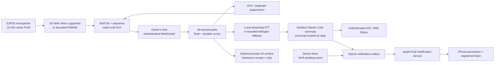

# Meetings, storage and notifications

## Data flow

The cloud bucket is not a substitute for connectivity. The ESP32 does not hold bucket credentials; the Hub streams the archive to the user's bucket. The supported 1.75C has no TF slot. Its PSRAM queue is approximately 98 seconds; capture stops with a visible message before overflow. Queued audio remains available while the device stays powered. A power loss without SD can lose unacknowledged audio. The software does not claim lossless recording under arbitrary hardware/power failures.

## Implemented safeguards

- One capture starts only on an explicit voice/device action or consent-confirmed UI action. A locked device refuses the remote request. UI start waits for actual server receipt rather than pretending recording started.
- Meeting buffers use PSRAM to preserve internal heap for TLS and peripherals. 512 ms blocks amortize durable-ACK latency; ordinary deep sleep waits for pending audio.
- `WAP1` frames carry a 32-bit sequence before a self-contained ADPCM block. Device retains the current frame until `meeting.ack`; timeout/reconnect resends it. Server duplicates do not increment audio duration. Bad ADPCM headers/order stop safely.
- Server persists the sequence cursor and PCM before acknowledging. A pending-write journal allows recovery of an interrupted unacknowledged append. No SD pins are probed on 1.75C.
- Recording ends after five hours, on explicit stop, or a capacity limit. The UI displays estimated remaining Hub capacity and maximum session time, not an unbounded promise. Battery time is separate.
- WAV encoding and final concatenation publish output atomically. If a part cannot encode, the original remains; a partial final movie is not advertised as a complete recording.
- Local transcription remains on the Hub; the transcript is sent to the isolated Claude Code model for summaries. Background processing does not share the interruptible chat task. Failed processing preserves audio and offers retry.
- Optional private S3 archives use TLS, SSE-S3 encryption request, SHA-256 metadata/size verification and durable receipts. Failed uploads retry after restart. Local eviction is **off** by default and occurs only after verified final archive and a saved transcript; no meeting is automatically deleted.
- Cloud playback uses a short-lived signed URL after owner authentication. Keep bucket public access blocked. Deletion removes known bucket objects before local records; if cloud deletion fails, local metadata is retained for retry. Bucket versioning may retain historical versions according to the owner's lifecycle settings.
- Push messages include event type/reference and generic text, never meeting text or summary. Tokens live only in the owner's protected Hub database. Opt-out, invalid-token removal, retry/backoff, expiry and event deduplication are implemented.

## Board status

| Board | TF slot | Shipping support |
|---|---|---|
| 1.75C silver round | No | RAM → Hub; physically testable here |
| 1.75 bare | Yes | No released Wappai BSP; do not install 1.75C firmware |
| 1.8 | Yes | V1/V2 display and touch differ; BSP and card behavior need physical qualification |
| 2.16 | Yes | BSP and card behavior need physical qualification |

`firmware/src/storage/recording_store.*` provides a gated SD_MMC spool, card presence/free-space status, WAV capture, queued upload reads and retained recordings. It requires explicit verified BSP pin definitions. It is **not** a released or hardware-validated SD feature on the future boards. SD insertion/removal, FAT recovery, long recording, card management and upload after a device power cycle must pass on each actual board before release. Do not advertise these boards as supported simply because the storage module compiles.

## References

- [Waveshare 1.75C](https://docs.waveshare.com/ESP32-S3-Touch-AMOLED-1.75C)
- [Waveshare 1.8 hardware revisions](https://docs.waveshare.com/ESP32-S3-Touch-AMOLED-1.8)
- [Waveshare 2.16 peripherals](https://docs.waveshare.com/ESP32-S3-Touch-AMOLED-2.16)
- [Espressif SD_MMC](https://docs.espressif.com/projects/arduino-esp32/en/latest/api/sdmmc.html)
- [Apple APNs server setup](https://developer.apple.com/documentation/usernotifications/setting-up-a-remote-notification-server)
- [Apple recording consent rule](https://developer.apple.com/app-store/review/guidelines/#software-requirements)
- [Boto3 file transfers](https://docs.aws.amazon.com/boto3/latest/guide/s3.html)
