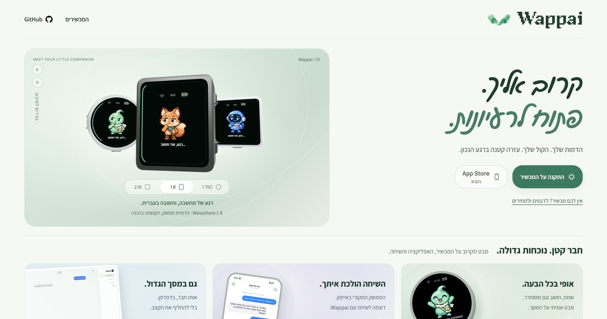

# Connection status and display contours — 2026-11-04

## Changes

- iOS distinguishes Hub connectivity from physical device connectivity. Device telemetry is handled globally, even while another conversation is selected. A cancelled reconnect task cannot close a newer socket. The app confirms the Hub connection only after receiving a message.
- The Hub sends an authoritative device snapshot after event replay and alongside its existing heartbeat. Simulator telemetry cannot mark physical hardware online. No extra ESP32 polling was added.
- Offline push-to-talk displays a Wi-Fi/Hub explanation before starting capture. A held BOOT button attempts recording once, and releasing a refused hold cannot become a tap.
- Rectangular displays use an inset rounded rectangle for the animated perimeter. Geometry is cached, motion follows perimeter distance, and dirty transfers cover straight edges and corners. The circular 466px panel retains its existing rendering path.
- The landing page's 1.8 and 2.16 previews and the device simulator use matching display outlines, including listening, thinking and timer states.
- Wi-Fi scans are serialized through the network task. Reconnection is paused before scanning, weak-network scans have longer dwell and a passive fallback, and radio sleep/autoreconnect settings are restored afterward.
- BLE diagnostic shutdown disconnects peers before destroying the server, avoiding a disconnect callback accessing freed server state. Optional staged radio diagnostics help isolate RF reception before/after peripheral startup.

## Validation performed

- Python server suite: **95 passed** in both private and sanitized public trees.
- iOS Debug simulator build and `testOfflineDeviceNoticeKeepsTextChatAvailable`: **passed**. The device-offline notice appears while text chat remains usable with a connected Hub.
- iOS Release device build: **passed**; installed and launched on the paired iPhone. This local install uses the existing no-Push signing override; repository APNs entitlements are preserved. No new physical touch test was performed.
- Firmware build: **passed**. Verified app-only flashing preserves NVS, ownership and network credentials.
- C++ ring and display-transfer suites under address/undefined-behavior sanitizers: **passed**, covering circle reference output, 368×448 and 480×480 contours, all four sides, corners, frame clearing, animation and buffer bounds.
- Physical device, offline BOOT hold and release: **passed**; `recording=0` and a visible Wi-Fi explanation. BLE shutdown diagnostic subsequently completed without the previously observed heap crash.
- Browser: rectangular and square landing previews inspected; simulator shape selection and animation loaded without JavaScript console errors. Landing deployment: **version 9**, source `551ba1554cdb43efa24c2aed0f4588bbb9240143`.

## Physical connectivity limitation

USB detection and flashing are verified. After the firmware update the physical device did not maintain a Wi-Fi/Hub connection. The nearby network is available in 2.4GHz, channel 11, WPA2-Personal, and its name matches the stored network. The Mac measured roughly -60 to -67 dBm; an isolated ESP32 scan intermittently detected channel-11 networks at roughly -85 to -88 dBm, while other scans returned no networks. Active/passive scans, awake radio, and BLE shutdown did not establish a reliable connection. This is not evidence of a 5GHz-only network or an incorrect password; the remaining reception problem is unresolved.

The UI must therefore report the device offline. A successful physical reconnect and online/offline/online round trip remain pending. Only the 1.75C hardware has been flashed here; rectangular rendering tests do not qualify the 1.8 or 2.16 hardware BSPs for release.

## Recovery

Private source restoration tag: `backup/pre-connection-frame-20261104` (baseline `0c3b266`). A fresh full 32MB flash image and SHA-256 manifest were saved privately before app-only flashing. The Hub's pre-deployment source archive was also saved privately. Recovery images and credentials are excluded from the public repository.

